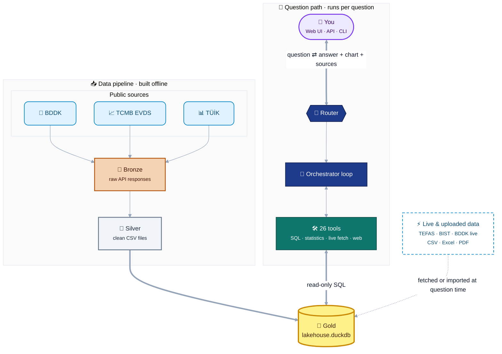
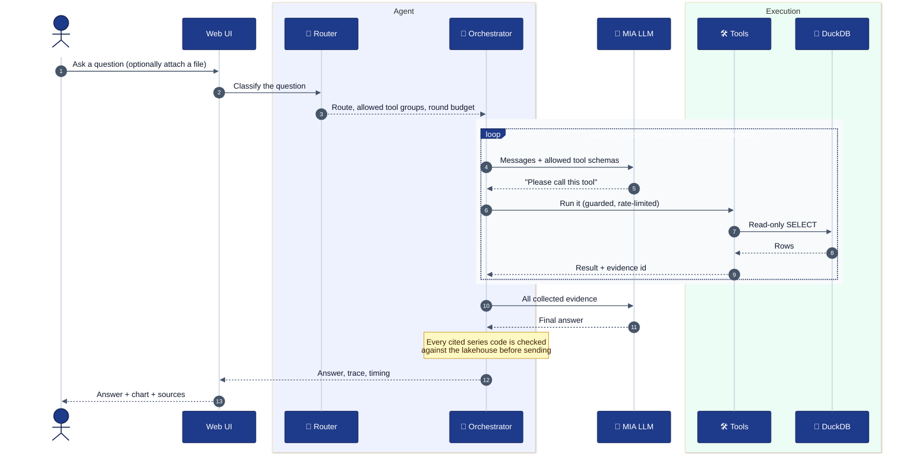
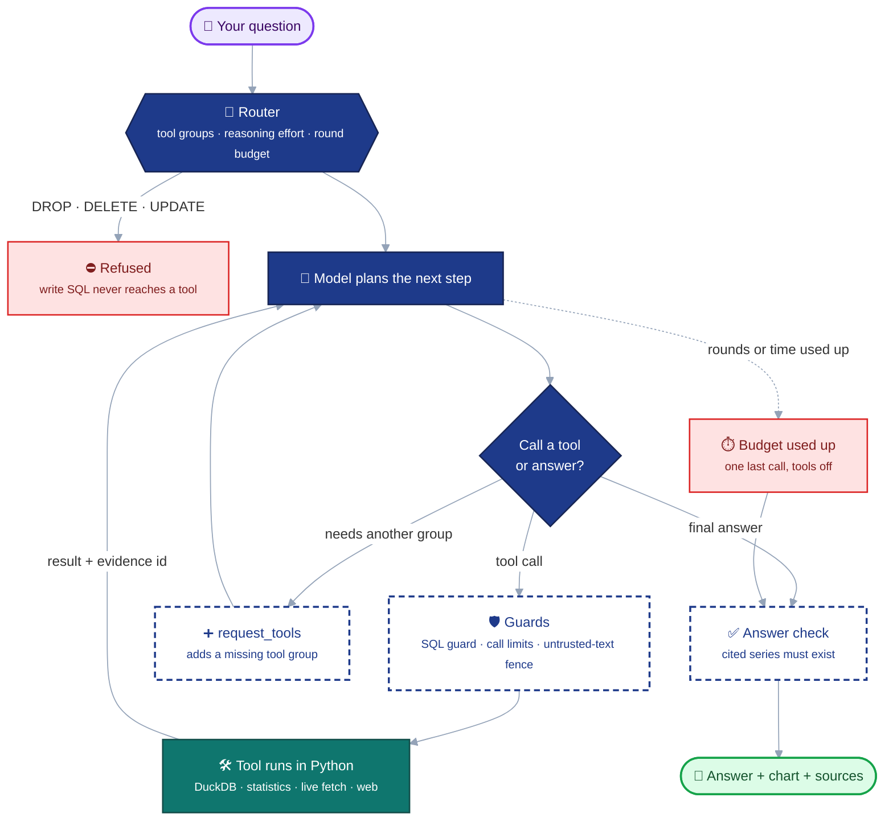
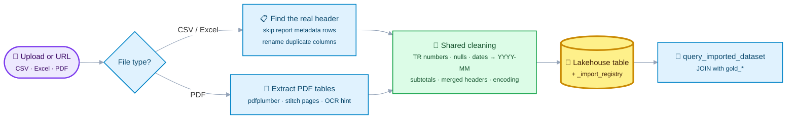

# KKB Agentic Data Analytics

**Ask questions about Turkish financial data in plain Turkish, and get answers you can trust.**


Turkey publishes a lot of useful financial data, but it is spread across
BDDK, TCMB EVDS, TÜİK and TEFAS, each with its own format and quirks. This
project pulls all of it into a single DuckDB database and puts an AI agent
on top, so you can simply ask something like *"Konut kredisi faizi ile
hacmi arasındaki ilişki nedir?"* and get an answer with a chart and sources.

The key idea: **the language model plans, Python does the math.** The model
decides which queries and analyses to run, but every query, statistic and
download is executed in real code. That means every number in an answer
comes from a real table and a real period, never from the model's memory.

| | |
|---|---|
| **Where the data comes from** | BDDK (monthly, weekly, FinTürk), TCMB EVDS, TÜİK SDMX, TEFAS, BIST, public URLs, and your own uploads (CSV, Excel, PDF) |
| **Where it is stored** | Bronze → silver → gold layers, ending in one `lakehouse.duckdb` file |
| **What does the thinking** | A router, an orchestrator loop and 26 tools (SQL, statistics, live fetch, web), running on the MIA / Qwen model |
| **How you use it** | A web UI with charts and a full trace of every function call, a REST API, or a CLI |

## Contents

1. [How it works](#how-it-works)
2. [What happens when you ask a question](#what-happens-when-you-ask-a-question)
3. [How the agent makes decisions](#how-the-agent-makes-decisions)
4. [How it reads files](#how-it-reads-files)
5. [Quick start](#quick-start)
6. [Troubleshooting](#troubleshooting)
7. [Code structure](#code-structure)
8. [Tools](#tools)
9. [Reliability, cost and benchmarks](#reliability-cost-and-benchmarks)

---

## How it works

Think of the system as two roads that meet at one database.

- On the **left**, public data is downloaded and cleaned step by step, from
  raw responses (bronze) to tidy CSVs (silver) to query-ready tables (gold).
- On the **right**, your question travels through a router and a tool loop,
  which reads from that same gold database to build the answer.



**Reading the diagram**

| Look | Meaning |
|---|---|
| 🥉 🥈 🥇 Bronze, silver, gold | The three cleanup stages, from raw response to query-ready table |
| Navy boxes | Parts that **decide** (router, orchestrator) |
| Teal box | Parts that **do the work** (tools) |
| Dashed arrow | Data that skips the batch pipeline (live fetches and your uploads) |

Because the agent can only get numbers through tools, every number in an
answer can be traced back to a table and a period. For a longer write-up in
Turkish, see [docs/agent_architecture.md](docs/agent_architecture.md).

## What happens when you ask a question

Here is one request from start to finish. The interesting part is the
shaded loop: the model asks for a tool, Python runs it, the result goes
back to the model, and this repeats until the model has enough evidence to
answer.



## How the agent makes decisions

Every question passes two checkpoints:

1. **The router** decides the plan's boundaries *before* the model is called.
2. **The model** decides the next step, one step at a time, inside the loop.

Guards sit between the model and the tools, so even a bad decision by the
model cannot write to the database or run away with calls.



**The router** (`src/agent/router.py`) sets three things up front:

- **Which tools the model may see.** The `core` group (schema, SQL,
  evidence) is always on. `analysis`, `regional`, `imports`, `live_fetch`
  and `web` are only added when the question needs them. If the model
  realizes it is missing a group, it can ask for it with `request_tools`.
- **How much effort to spend.** Each route has its own prompt add-on,
  reasoning effort and round limit. A simple lookup gets a small, cheap
  budget; a multi-series comparison gets more rounds.
- **What is not allowed.** Write statements (`DROP`, `DELETE`, `UPDATE`,
  ...) are refused outright. Text that looks like prompt injection is
  flagged rather than blocked, because the real safety boundary is the
  read-only connection and the SQL guard.

**The orchestrator** (`src/agent/orchestrator.py::ask`) runs the loop: call
the model, run the requested tools, feed the results back, repeat. If time
or rounds run out, it doesn't just fail. It makes one final call with tools
turned off, and the model has to answer from the evidence it already has.

Every routed question and its route are listed in
[docs/router_prompt_matrix.md](docs/router_prompt_matrix.md).

## How it reads files

Files can come in two ways: through the batch pipeline, or as uploads while
you're asking a question. Either way they end up in the same database, so
the agent can `JOIN` your uploaded file with the curated `gold_*` tables in
a single query.



**Batch sources** (BDDK, EVDS, TÜİK) follow a fixed path: a collector in
`src/collectors/` downloads the raw file, `src/processing/` turns it into a
silver CSV, and `src/gold/build_gold.py` loads it into `gold_*` tables.

**Uploads** (CSV, Excel, PDF, up to 25 MB) are messier, because real-world
exports rarely start with a clean header. A TEFAS export, for example, puts
an export date and a record count above the actual table. So the reader:

- looks for the real header row and skips the metadata above it,
- renames duplicate column names (`Deger`, `Deger_1`) instead of rejecting the file,
- stitches PDF tables that are split across pages back together,
- and if no table passes the strict header checks, still imports the
  largest one, naming blank headers `Kolon_N`.

Both paths then share one cleaning step (`src/agent/data_cleaning.py`),
which handles the usual headaches:

- Turkish and international number formats, including shorthand like `1.5M` and `2,3 milyar`
- Mixed empty-value markers (`-`, `N/A`, `#REF!`, blank)
- Mixed date formats, all normalized to `YYYY-MM`
- Subtotal rows like `Toplam`, which are dropped so nothing is counted twice
- Merged Excel headers, hidden rows and hidden columns
- Garbled Turkish characters

Nothing is changed silently: every fix is listed in a `data_quality` field.
Uploaded tables can never overwrite a `gold_*` table. They are tracked in
`_import_registry`, so any answer that uses one clearly marks it as
user-supplied and unverified.

---

## Quick start

### What you need

| Needed | Version | Why |
|---|---|---|
| Python | **3.11** (what CI tests) | pandas 3 doesn't support 3.10 or older |
| Git | any | to clone the repo |
| MIA API key | – | the language model; goes in `.env` |
| Docker | optional | for self-hosted web search (SearXNG) |

Good news: the data you need is already in the repo (`data/silver/`), so
you can build the database offline, without any data-source API keys.

### 1. Install and run

<details open>
<summary><b>Windows (PowerShell)</b></summary>

```powershell
cd C:\                                         # a short path avoids the 260-char limit
git clone https://github.com/berataydemirr/albert-long-nodes-kkb-hackathon.git kkb_agentic_ai
cd kkb_agentic_ai

py -3.11 -m venv .venv
.venv\Scripts\python -m pip install --upgrade pip
.venv\Scripts\python -m pip install -r requirements.txt

Copy-Item .env.example .env
notepad .env                                   # set MIA_API_KEY=...

.venv\Scripts\python -m src.gold.build_gold    # builds data\gold\lakehouse.duckdb
.venv\Scripts\python -m uvicorn web_app:app --host 127.0.0.1 --port 8000
```

Three things that commonly trip people up on Windows:

- **Keep the folder path short** (e.g. `C:\kkb_agentic_ai`). Windows limits
  paths to 260 characters, and one statsmodels file sits about 120
  characters deep inside `.venv`. From a long path (OneDrive, deeply nested
  folders), `pip install` stops halfway with `OSError: [Errno 2] No such
  file or directory`. If you'd rather keep your path, enable long paths
  once, as admin:
  `New-ItemProperty -Path HKLM:\SYSTEM\CurrentControlSet\Control\FileSystem -Name LongPathsEnabled -Value 1 -PropertyType DWORD -Force`
- **Use `py -3.11`, not `python3`.** On Windows, `python3` usually opens the
  Microsoft Store instead of Python.
- **You don't need to activate the venv.** The commands call
  `.venv\Scripts\python` directly, so you can skip `Activate.ps1`, which
  PowerShell's execution policy often blocks anyway.
</details>

<details open>
<summary><b>macOS / Linux</b></summary>

```bash
git clone https://github.com/berataydemirr/albert-long-nodes-kkb-hackathon.git kkb_agentic_ai
cd kkb_agentic_ai

python3.11 -m venv .venv          # `python3 --version` must print 3.11.x
.venv/bin/python -m pip install --upgrade pip
.venv/bin/python -m pip install -r requirements.txt

cp .env.example .env
nano .env                          # set MIA_API_KEY=...

.venv/bin/python -m src.gold.build_gold
.venv/bin/python -m uvicorn web_app:app --host 127.0.0.1 --port 8000
```
</details>

Now open <http://127.0.0.1:8000>. You'll find ready-made example questions
to try. For every answer, the page shows which route was taken and each
function call with its arguments and result, so you can see exactly how
the answer was built.

### 2. Check that it's running

```bash
curl.exe http://127.0.0.1:8000/health     # Windows (plain `curl` is a PowerShell alias)
curl http://127.0.0.1:8000/health         # macOS / Linux
# -> {"status":"ok"}
```

Or skip the server and ask straight from the terminal:

```bash
.venv/bin/python agent.py "Konut kredisi faizi ile hacmi arasındaki ilişki nedir?"
```

### 3. Optional extras

| Feature | How to enable | What happens without it |
|---|---|---|
| Reliable web search | `docker compose -f docker-compose.searxng.yml up -d`, then set `WEB_SEARCH_PROVIDER=searxng` in `.env` | Falls back to DuckDuckGo, which some networks block |
| JavaScript-rendered pages (TÜİK bulletins, EVDS) | `.venv/bin/python -m playwright install chromium` | Those pages come back empty, and the agent tells you so |
| OCR for scanned PDFs and images | Install the Tesseract binary | Scanned pages are reported as having no table |

Run the Docker command from the repo root: it mounts
`./searxng/settings.yml`, which turns on the JSON API the agent needs. The
container restarts with Docker, so after a reboot it comes back as soon as
Docker Desktop is open.

### Environment variables

`.env` is read only once, when the process starts, so **restart the server
after editing it.**

| Variable | Required | Used for |
|---|---|---|
| `MIA_API_KEY` | **yes** | Every model call |
| `EVDS_API_KEY` | no | Live EVDS fetches and re-running the EVDS collector |
| `TUIK_API_KEY` | no | Live TÜİK refresh and re-running the TÜİK collector |
| `WEB_SEARCH_PROVIDER` | no | `duckduckgo` (default) or `searxng` |
| `DEMO_AUTH_USER`, `DEMO_AUTH_PASS` | no | HTTP basic auth on the web UI (only when both are set) |

### Updating after `git pull`

A pull can bring new gold tables, but the database file itself isn't in
Git. Rebuild it after pulling, otherwise the agent will look for tables
that don't exist yet:

```bash
# 1. stop the server first: DuckDB allows only one writer
git pull
.venv/bin/python -m pip install -r requirements.txt
.venv/bin/python -m src.gold.build_gold     # keeps your uploaded tables
# 2. start the server again
```

`data/data.zip` (~100 MB) is a full offline snapshot with the raw bronze
files and a prebuilt database. You only need it if you want the raw files
back. Extract it **only into a fresh clone**, since it overwrites
`data/silver/`, `data/gold/` and any uploaded tables.


---

## Code structure

Each stage lives in its own module with its own tests, so changing one
stage doesn't ripple into the others.

| Layer | Path | What it does |
|---|---|---|
| Collect | `src/collectors/` | Downloads BDDK, EVDS and TÜİK sources |
| Process | `src/processing/` | Cleans bronze into silver |
| Build | `src/gold/` | Loads silver into DuckDB; builds aligned deposit, CPI and TEFAS tables |
| Route | `src/agent/router.py` | Classifies questions, picks tool groups and budgets |
| Reason | `src/agent/orchestrator.py` | Model loop, prompts, forced final answer |
| Act | `src/agent/tools.py` | Tool schemas and implementations (26 tools) |
| Import | `src/agent/data_import.py`, `pdf_import.py`, `data_cleaning.py` | Reads and cleans CSV, Excel and PDF |
| Live data | `src/agent/bddk_live.py`, `tefas_volume.py`, `finance_fetch.py`, `bist_import.py` | Fetches official JSON endpoints at question time |
| Web | `src/agent/web_search.py`, `web_url.py` | Search and URL reading, with a browser fallback for JS pages |
| Safety | `src/agent/sql_guard.py`, `untrusted.py`, `hallucination_guard.py`, `grounding.py` | Read-only SQL, fenced third-party text, answer checks |
| Memory | `src/agent/evidence.py`, `context_compactor.py` | Immutable tool evidence, bounded context size |
| Serve | `web_app.py`, `static/design/`, `agent.py` | FastAPI app, browser UI, CLI |
| Verify | `tests/`, `benchmarks/` | Unit tests, adversarial and latency benchmarks |

Building the gold database needs no network: it reads only the silver files
in the repo. The collectors need their source keys in `.env`, and you only
run them when you want to refresh the data.

---

## Tools

To keep the model focused, the router only shows it the tool groups a
question actually needs.

| Group | Tools |
|---|---|
| `core` | `lakehouse_schema`, `lakehouse_query`, `search_bddk_items`, `evidence_query`, `recall_turn` |
| `analysis` | `anomaly_analysis`, `change_detection`, `correlation_analysis`, `causality_analysis`, `threshold_filter_compare`, `credit_elasticity_analysis`, `evidence_correlation` |
| `regional` | `compare_regions` (province-level ranking across 35 lending, deposit and credit-quality metrics) |
| `imports` | `list_imported_datasets`, `query_imported_dataset`, `fuzzy_match_category` |
| `live_fetch` | `search_evds_series`, `fetch_evds_series`, `refresh_tuik_series`, `search_tuik_dataflows`, `fetch_tefas_volume`, `fetch_bist_stock` |
| `web` | `web_search`, `web_url_extract`, `import_url_dataset`, `fetch_bddk_monthly_table` |

A few design choices worth knowing:

- Analysis tools take a **series code** and read the data from the database
  themselves, so the model never has to retype (and possibly mistype) numbers.
- Charts are built from tool results, not drawn by the model.
- Every chart states its unit and source, with a table view underneath.

---

## Reliability, cost and benchmarks

**Staying reliable.** Each tool has a per-answer call limit: 3 by default,
8 for SQL queries, and up to 20 for analysis tools. Calling the exact same
tool with the exact same arguments twice is always refused. Text coming
from web pages, PDFs and uploaded cells is fenced off as untrusted before
the model sees it. And if the budget runs out, the model still answers from
the evidence it has collected.

**Keeping it fast and cheap.** Almost all the waiting time is model time,
so that's where the optimizations go: the series catalog is included in the
system prompt, analysis tools read series by code, and
`MIA_REASONING_EFFORT` (default `low`) controls how hard the model thinks.
Together these brought a representative question down from **32.4 s to
7.9 s**. Older tool outputs are also summarized once the history grows past
a size budget.

```bash
.venv/bin/python -m pytest -q                               # unit tests
.venv/bin/python -m benchmarks.hard_benchmark               # 153 adversarial questions, ~20 min
.venv/bin/python -m benchmarks.adversarial_excel_benchmark  # trap questions on real TCMB files
.venv/bin/python -m benchmarks.web_tool_benchmark           # web search / URL regression
.venv/bin/python -m benchmarks.context_cost_benchmark       # local, no API calls
```

`hard_benchmark` covers 24 categories, including multi-hop chains,
malformed parameters, prompt injection, live BIST and TÜİK fetches, SQL
guardrails and unit traps. It measures tool-selection accuracy, numeric
grounding, consistency, speed, hallucination rate, and whether the agent
honestly admits when data is missing.

The numeric grounding check compares every number in an answer against
what the tools returned, allowing for simple derived math. It's a
heuristic, so ambiguous cases are logged for manual review rather than
auto-judged.

Tool calls and model rounds are logged to `logs/`. Secrets, logs, the
virtual environment and the DuckDB file are all ignored by Git.
