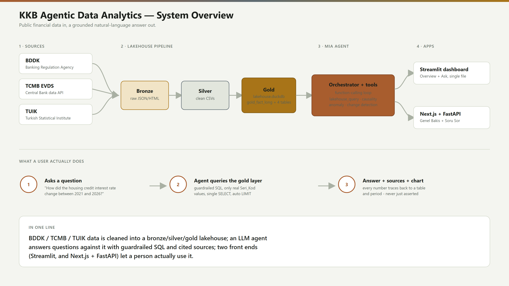

# KKB data agent

Turns BDDK, EVDS and TUIK data into a queryable DuckDB database, then
answers questions about it through a tool-calling MIA agent. The model
plans; Python runs the tools and keeps the data work local.

## Run it locally

```bash
python3 -m venv .venv
.venv/bin/pip install -r requirements.txt
cp .env.example .env
# add MIA_API_KEY to .env
.venv/bin/python -m src.gold.build_gold
.venv/bin/uvicorn web_app:app --reload
```

Open <http://127.0.0.1:8000>. The page shows ready-made prompts, the route a
request took, and every function call with its arguments and result.

CLI equivalent:

```bash
.venv/bin/python agent.py "Konut kredisi faizi ile hacmi arasındaki ilişki nedir?"
```

## Architecture

### System overview



Public data from BDDK, TCMB EVDS and TUIK is cleaned into a bronze, silver
and gold DuckDB lakehouse. An MIA model plans the work; Python runs every
tool call and keeps the actual data processing local. Every number the
agent states in an answer can be traced back to a table and a period, it is
never just asserted from the model's own memory. A full Turkish walkthrough
of the flow is in [docs/agent_architecture.md](docs/agent_architecture.md).

### Modular code structure

The codebase is split into independent modules. Each one has its own file
and its own test file, so a change in one stage does not require touching
the others:

```text
src/
  collectors/     source downloads (BDDK, EVDS, TUIK)
  processing/     bronze to silver conversion
  gold/           silver to DuckDB build
  agent/
    router.py         question classification and per-route settings
    orchestrator.py    the model loop, one tool call at a time
    tools.py           lakehouse query and analysis tool implementations
    data_import.py     CSV/Excel reading and schema detection
    pdf_import.py      PDF table extraction
    bist_import.py     live BIST stock price fetch
    series_resolver.py series catalog and lookup by code
    charts.py          chart data built from tool results
web_app.py        FastAPI app, /api/ask and /api/upload
static/design/    browser UI
tests/            one test file per module above
docs/             architecture, schema and routing reference docs
```

The gold build step is network free, it only reads the checked in silver
files. Collectors need their own source keys in `.env` and are only run
when refreshing the data.

### Document reading approach

A document can enter the system two ways, and both end up in the same
lakehouse so the rest of the pipeline never needs to know which one was
used:

1. **Batch sources** (BDDK, EVDS, TUIK). A collector in `src/collectors/`
   downloads the raw file, `src/processing/` cleans it into a silver CSV,
   and `src/gold/build_gold.py` loads it into `gold_*` tables.
2. **Runtime uploads** (CSV, Excel, PDF, up to 25 MB). `data_import.py`
   reads a CSV or Excel file and detects its schema; `pdf_import.py` uses
   `pdfplumber` to find tables from ruling lines or aligned text. A broken
   extraction (blank or duplicate header) is rejected instead of guessed
   at, and a table split across pages is stitched back together.

Both paths share one cleaning step (`data_cleaning.py`) before the data is
written: Turkish and international decimal notation, mixed null markers,
mixed date formats, subtotal rows, merged Excel headers and mangled text
encoding are all normalized, and every change is reported in a
`data_quality` field rather than applied silently.

The same design is used internally for the agent's own working memory: the
`src/agent/` package reads a question, extracts what it needs (series
codes, periods, regions) and only then hands the rest to the model, so the
model is reasoning over structured facts, not raw document text.

### Agentic decision-making and task processing

Every question goes through the same loop:

```text
Question
   -> Router (classify, pick tool groups and a reasoning budget)
   -> Model call (plans the next step, may call zero or more tools)
   -> Tool execution (Python, not the model)
   -> Result goes back to the model
   -> Model calls another tool, or writes the final answer
```

`src/agent/router.py` decides three things before any model call happens:

- which **tool groups** are exposed (`core` is always on; `analysis`,
  `regional`, `imports`, `live_fetch` and `web` are added when the
  question's wording signals a need for them, and the model itself can
  request a missing group with `request_tools`)
- a per-route **prompt add-on**, **reasoning effort** and **round budget**
  (a single lookup gets a small, cheap budget; a multi-series comparison
  gets more rounds and a matching reasoning budget)
- **policy**: a write statement (`DROP`, `DELETE`, `UPDATE`, ...) is
  refused outright, and prompt-injection-looking phrasing is flagged in
  the prompt rather than blocked, since the real safety boundary is the
  read-only connection and the SQL guard, not a keyword match

`src/agent/orchestrator.py::ask()` then runs the loop: it calls the model,
executes whatever tool calls come back, feeds the results back in, and
repeats until the model returns a final answer or the round or time budget
runs out. If the budget runs out first, one last call is made with tools
disabled, forcing a text answer from whatever evidence was already
gathered instead of failing silently. The full routing matrix (every
tested question and the route it takes) is in
[docs/router_prompt_matrix.md](docs/router_prompt_matrix.md).

## Tools

The router exposes every registered tool for a safe request, so one answer
can combine several:

- `lakehouse_schema`, `lakehouse_query` — inspect and query the gold database
- `anomaly_analysis`, `change_detection` — unusual points and sharp moves in a series
- `correlation_analysis`, `causality_analysis`, `threshold_filter_compare` — compare two series
- `compare_regions` — rank provinces across 35 lending, deposit and credit-quality metrics
- `list_imported_datasets`, `query_imported_dataset` — read a user-uploaded CSV/Excel/PDF table
- `refresh_tuik_series`, `search_tuik_dataflows` — re-fetch a registered TUIK series, or search the catalog for an unregistered one
- `fetch_bist_stock` — pull a BIST stock's live price history
- `fuzzy_match_category` — reconcile a category name across sources with no shared code
- `web_search`, `web_url_extract` — look up public information and read a given URL

Analysis tools take a `seri_kod` and read the series from the database
directly, rather than the model retyping numbers. Answers with chartable
data get a chart built from the tool results, not generated by the model —
each states its unit and source and has a table view underneath. Unsafe
SQL and prompt-injection attempts are refused before the model gets any
tools.

## Data import

Uploading a CSV, Excel or PDF (up to 25 MB) detects its schema and loads it
into `lakehouse.duckdb` — the same database the curated `gold_*` tables
live in, so an import can be `JOIN`ed against them immediately. Imported
tables can never collide with a `gold_*` name and are tracked in
`_import_registry`, so any answer citing one can flag it as user-supplied
and unverified.

PDF import (`pdfplumber`, pure Python) finds tables from ruling lines or
aligned text; a broken extraction (blank/duplicate header) is rejected
rather than guessed at, and a table split across pages is stitched back
together automatically.

### Data cleaning

Both import paths (`src/agent/data_cleaning.py`) clean the data before
schema detection and report every change in a `data_quality` field:

- Turkish vs. international decimal notation, and abbreviated magnitudes (`1.5M`, `2,3 milyar`)
- Inconsistent null markers (`-`, `N/A`, `#REF!`, blank) unified to one real null
- Mixed date formats normalized to a `YYYY-MM` Period convention
- Subtotal rows excluded rather than double-counted
- Merged Excel headers recovered as real, distinct columns
- Hidden Excel rows/columns excluded
- Mangled Turkish text (wrong-codec round trip) repaired and verified

`fuzzy_match_category` reconciles a category name across sources that
don't share a code (BDDK's `Tarım, Avcılık ve Ormancılık` vs. TUIK's
`Tarım`). `refresh_tuik_series` re-fetches an already-registered TUIK
series live; an unregistered key is never guessed, since TUIK's SDMX API
needs the series resolved by hand first — `search_tuik_dataflows` finds
candidates instead. `fetch_bist_stock` is not restricted to a registry: any
real BIST ticker works directly.

## Web search

The default provider, DuckDuckGo's public endpoint, can return a bot
challenge from some networks. The supported alternative is a self-hosted
SearXNG instance:

```bash
docker compose -f docker-compose.searxng.yml up -d
# then in .env: WEB_SEARCH_PROVIDER=searxng, SEARXNG_BASE_URL=http://localhost:8888
```

Not persistent — start the container again after a machine restart. A
blocked provider reports itself as unavailable rather than an empty result
list, so the model doesn't mistake a block for "no matches" and retry.

## Reliability

Each tool has its own per-answer call limit (`web_search`/`lakehouse_query`
capped at three; analysis tools up to ten, for legitimate multi-series
questions). An identical repeat call is always refused. If the round
budget runs out before a final answer, one more call is made with tools
disabled to force a text answer from what was already gathered.

## Data layout

- `data/bronze/` — source responses
- `data/silver/` — cleaned CSVs
- `data/gold/lakehouse.duckdb` — analysis-ready tables, rebuilt locally
- `src/collectors/` — source downloads
- `src/processing/` — bronze to silver conversion
- `src/gold/` — silver to DuckDB build
- `src/agent/` — router, model loop and tools
- `docs/` — schema, routing and [agent architecture](docs/agent_architecture.md)

The gold build is network-free; it reads the checked-in silver files. The
collectors need the relevant source keys in `.env`.

## Cost and speed

Wall time is almost entirely the model, not the data layer. The series
catalog is injected into the system prompt (no round spent discovering
codes), analysis tools read a series by code instead of the model
retyping it, and `MIA_REASONING_EFFORT` (default `low`) controls
per-call reasoning depth without trading off accuracy. Together these cut
a representative question from 32.4 s to 7.9 s. Older tool outputs are
digested once conversation history passes a size budget, controlling cost
without dropping a message.

```bash
.venv/bin/python -m benchmarks.context_cost_benchmark       # local, no API calls
.venv/bin/python -m benchmarks.reasoning_effort_benchmark   # hits the API
```

## Checks

```bash
.venv/bin/python -m pytest -q
```

Tool calls and model rounds are written to `logs/`. Secrets, generated
logs, the virtual environment and the DuckDB file are ignored by Git.

## Benchmarks

```bash
.venv/bin/python -m benchmarks.hard_benchmark               # 153 questions, ~20 min
.venv/bin/python -m benchmarks.adversarial_excel_benchmark  # real TCMB files in test_excels/
.venv/bin/python -m benchmarks.web_tool_benchmark           # web_search / web_url_extract regression
```

`hard_benchmark.py` runs 153 adversarial and edge-case questions across 24
categories — multi-hop chains, malformed parameters, prompt injection,
live BIST/TUIK fetches, SQL guardrails, unit traps and more — tracking
tool-selection accuracy, numeric grounding, consistency, speed,
hallucination rate, missing-data admission and guardrail robustness.

**Numeric grounding.** Calling the right tool doesn't guarantee the model
reports its result correctly in prose. This check compares every number
in an answer against what the tools actually returned, allowing for
simple derived math (percentages, unit conversions, rounding). It's a
heuristic, not a hard gate — genuinely ambiguous numbers are logged for
manual review rather than auto-failed.

`adversarial_excel_benchmark.py` runs hand-crafted trap questions against
real TCMB files in `test_excels/` (region-code meanings, methodology
mismatches, unit traps), each with a documented ground truth.
`web_tool_benchmark.py` checks that `web_search`/`web_url_extract`
actually reach the internet and that the model verifies terminology
instead of guessing.
