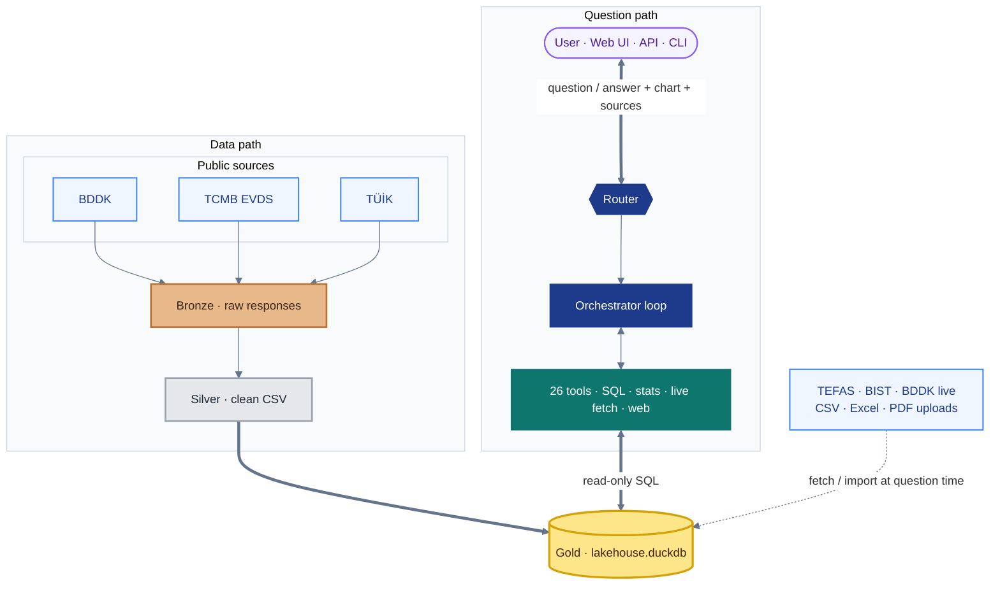
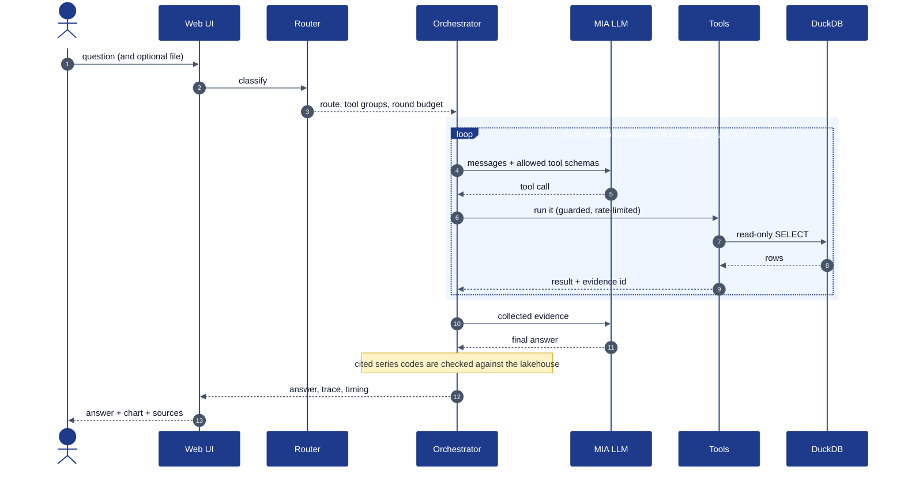
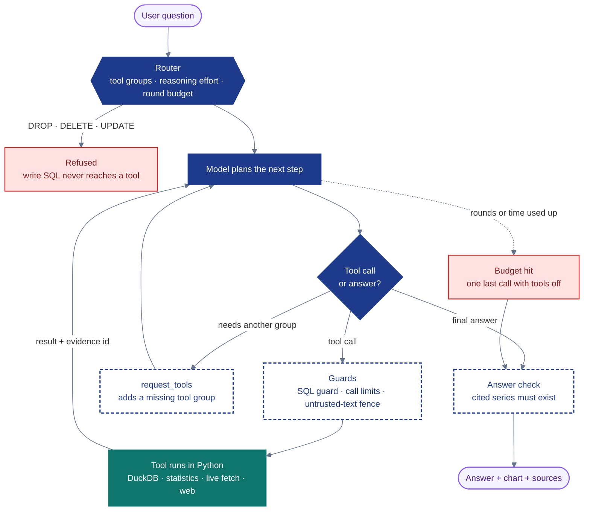
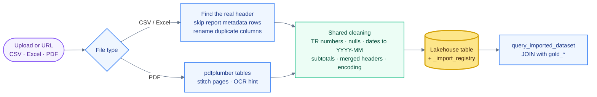

# KKB Agentic Data Analytics

**An autonomous lakehouse and reasoning agent for Turkish financial public data**


BDDK, TCMB EVDS, TÜİK and TEFAS data is collected into one DuckDB
lakehouse. A tool-calling agent then answers questions about it in Turkish.
The model only plans. Python runs every query, statistic and download, so
every number in an answer comes from a real table and a real period.

| | |
|---|---|
| **Sources** | BDDK (monthly, weekly, FinTürk), TCMB EVDS, TÜİK SDMX, TEFAS, BIST, public URLs, user uploads (CSV, Excel, PDF) |
| **Storage** | Bronze, silver and gold layers ending in a single `lakehouse.duckdb` file |
| **Agent** | Router, orchestrator loop and 26 tools (SQL, statistics, live fetch, web), running on the MIA / Qwen model |
| **Interfaces** | Web UI with charts and a full function-call trace, a REST API and a CLI |

## Contents

1. [Quick start](#quick-start)
2. [Troubleshooting](#troubleshooting)
3. [System overview](#system-overview)
4. [Agentic decision-making and task processing](#agentic-decision-making-and-task-processing)
5. [Document reading approach](#document-reading-approach)
6. [Modular code structure](#modular-code-structure)
7. [Tools](#tools)
8. [Reliability, cost and benchmarks](#reliability-cost-and-benchmarks)

---

## Quick start

### Requirements

| Needed | Version | Why |
|---|---|---|
| Python | **3.11** (the version CI tests) | pandas 3 does not support 3.10 or older |
| Git | any | clone the repo |
| MIA API key | – | the language model, set in `.env` |
| Docker | optional | self-hosted web search (SearXNG) |

The data needed to run is already in the repo (`data/silver/`), so the
database is built offline with no API keys.

### 1. Install and run

<details open>
<summary><b>Windows (PowerShell)</b></summary>

```powershell
cd C:\                                         # a short path avoids the 260-char limit
git clone https://github.com/berataydemirr/albert-long-nodes-kkb-hackathon.git kkb_agentic_ai
cd kkb_agentic_ai

py -3.11 -m venv .venv
.venv\Scripts\python -m pip install --upgrade pip
.venv\Scripts\python -m pip install -r requirements.txt

Copy-Item .env.example .env
notepad .env                                   # set MIA_API_KEY=...

.venv\Scripts\python -m src.gold.build_gold    # builds data\gold\lakehouse.duckdb
.venv\Scripts\python -m uvicorn web_app:app --host 127.0.0.1 --port 8000
```

Three Windows traps:

- **Keep the folder path short** (for example `C:\kkb_agentic_ai`). Windows
  limits paths to 260 characters, and one statsmodels file sits about 120
  characters deep inside `.venv`. From a long path (OneDrive, deeply nested
  folders), `pip install` stops halfway with `OSError: [Errno 2] No such
  file or directory`. Alternatively, enable long paths once, as admin:
  `New-ItemProperty -Path HKLM:\SYSTEM\CurrentControlSet\Control\FileSystem -Name LongPathsEnabled -Value 1 -PropertyType DWORD -Force`
- **Use `py -3.11`, not `python3`.** On Windows, `python3` usually opens the
  Microsoft Store instead of Python.
- **No activation needed.** The commands call `.venv\Scripts\python`
  directly, so you never need `Activate.ps1`, which PowerShell's execution
  policy often blocks.
</details>

<details open>
<summary><b>macOS / Linux</b></summary>

```bash
git clone https://github.com/berataydemirr/albert-long-nodes-kkb-hackathon.git kkb_agentic_ai
cd kkb_agentic_ai

python3.11 -m venv .venv          # `python3 --version` must print 3.11.x
.venv/bin/python -m pip install --upgrade pip
.venv/bin/python -m pip install -r requirements.txt

cp .env.example .env
nano .env                          # set MIA_API_KEY=...

.venv/bin/python -m src.gold.build_gold
.venv/bin/python -m uvicorn web_app:app --host 127.0.0.1 --port 8000
```
</details>

Open <http://127.0.0.1:8000>. The page has ready-made example questions. For
every answer it shows the route taken and each function call with its
arguments and result.

### 2. Check that it started

```bash
curl.exe http://127.0.0.1:8000/health     # Windows (plain `curl` is a PowerShell alias)
curl http://127.0.0.1:8000/health         # macOS / Linux
# -> {"status":"ok"}
```

Or ask from the terminal, without the server:

```bash
.venv/bin/python agent.py "Konut kredisi faizi ile hacmi arasındaki ilişki nedir?"
```

### 3. Optional extras

| Feature | Command | Without it |
|---|---|---|
| Reliable web search | `docker compose -f docker-compose.searxng.yml up -d`, then set `WEB_SEARCH_PROVIDER=searxng` in `.env` | Falls back to DuckDuckGo, which some networks block |
| JavaScript-rendered pages (TÜİK bulletins, EVDS) | `.venv/bin/python -m playwright install chromium` | Those pages come back empty and the agent says so |
| OCR for scanned PDFs and images | Install the Tesseract binary | Scanned pages are reported as having no table |

Run the Docker command from the repo root. It mounts `./searxng/settings.yml`,
which turns on the JSON API the agent needs. The container restarts with
Docker, so after a reboot it runs again once Docker Desktop is open.

### Environment variables

`.env` is read once, when the process starts. **Restart the server after
you edit it.**

| Variable | Required | Used for |
|---|---|---|
| `MIA_API_KEY` | **yes** | Every model call |
| `EVDS_API_KEY` | no | Live EVDS fetches and re-running the EVDS collector |
| `TUIK_API_KEY` | no | Live TÜİK refresh and re-running the TÜİK collector |
| `WEB_SEARCH_PROVIDER` | no | `duckduckgo` (default) or `searxng` |
| `DEMO_AUTH_USER`, `DEMO_AUTH_PASS` | no | HTTP basic auth on the web UI, only when both are set |

### Updating after `git pull`

A pull can add new gold tables, but the database file is not in Git.
Rebuild it, or the agent will look for tables that do not exist yet:

```bash
# 1. stop the server first: DuckDB allows only one writer
git pull
.venv/bin/python -m pip install -r requirements.txt
.venv/bin/python -m src.gold.build_gold     # keeps your uploaded tables
# 2. start the server again
```

`data/data.zip` (~100 MB) is a full offline snapshot: raw bronze files and a
prebuilt database. You only need it to restore the raw files. Extract it
**only into a fresh clone**, because it overwrites `data/silver/`,
`data/gold/` and any uploaded tables.

---

## Troubleshooting

| Symptom | Cause | Fix |
|---|---|---|
| `python3` opens the Microsoft Store | Windows app alias | Use `py -3.11 -m venv .venv` |
| `pip install` fails building pandas or numpy | Wrong Python version | Delete `.venv` and recreate it with Python 3.11 |
| `pip install` fails with `OSError: [Errno 2] ... statsmodels\...` and a "Long Path" hint | Windows 260-character path limit | Move the repo to a short path such as `C:\kkb_agentic_ai`, delete `.venv`, install again. Or enable long paths (see Windows setup) |
| `ModuleNotFoundError: No module named 'pdfplumber'` (or another package) | A previous `pip install` stopped halfway | Fix the cause above, then run `pip install -r requirements.txt` again |
| `Gold database not found ... Run python -m src.gold.build_gold first` | Database never built | Run `python -m src.gold.build_gold` |
| `IO Error: Could not set lock on file ... lakehouse.duckdb` | The server is still running during a rebuild | Stop the server, rebuild, start again |
| `[Errno 10048]` / `address already in use` on port 8000 | An old uvicorn is still running (common after `--reload`) | Windows: `netstat -ano \| findstr :8000`, then `taskkill /PID <pid> /F`. macOS/Linux: `lsof -ti :8000 \| xargs kill`. Or use `--port 8001` |
| Health is `ok` but new features are missing | An old process still holds the port, and the new one crashed on start | Check the server log for a bind error, kill the old process and start again |
| `Unknown table(s) referenced: ['gold_...']` after a pull | Code is new, database is old | Stop the server and run `build_gold` |
| `Agent yanıt üretemedi` or `MIA_API_KEY is missing` | Key not in `.env`, or `.env` was edited after start | Put `.env` in the repo root, set the key, restart |
| Web search reports "unavailable" | DuckDuckGo bot challenge | Use SearXNG (see above), then restart the server |
| SearXNG returns `403` | Compose was run outside the repo root, so `settings.yml` is not mounted | `docker compose -f docker-compose.searxng.yml down`, then `up -d` from the repo root |
| Turkish characters garbled in a Windows terminal | Console codepage cp1254 | `agent.py` handles this. For your own scripts, set `PYTHONIOENCODING=utf-8` |

---

## System overview

Two paths meet in one database. Public data flows down the left, cleaned
layer by layer. Questions flow down the right, through the router and the
tool loop. Both end at the same DuckDB file.



| Color | Meaning |
|---|---|
| Bronze, silver, gold | The three cleanup stages, from raw response to query-ready table |
| Navy | Makes decisions (router, orchestrator) |
| Teal | Does work (tools) |
| Dashed arrows | Data that skips the batch pipeline (live fetches and uploads) |

Every number in an answer points back to a table and a period. The agent
never states a number from memory. A longer Turkish write-up is in
[docs/agent_architecture.md](docs/agent_architecture.md).

### One request, end to end



---

## Agentic decision-making and task processing

Each question passes through two decision points. The **router** decides
before any model call. The **model** decides one step at a time inside
the loop.



**The router** (`src/agent/router.py`) sets three things before the first
model call:

- **Tool groups.** `core` (schema, SQL, evidence) is always on. `analysis`,
  `regional`, `imports`, `live_fetch` and `web` are added when the question
  needs them. The model can add a missing group itself with `request_tools`.
- **Budget.** Each route gets its own prompt add-on, reasoning effort and
  round limit. A single lookup gets a small, cheap budget. A multi-series
  comparison gets more rounds.
- **Policy.** Write statements (`DROP`, `DELETE`, `UPDATE`, ...) are
  refused outright. Injection-looking text is flagged rather than blocked,
  because the real boundary is the read-only connection and the SQL guard.

**The orchestrator** (`src/agent/orchestrator.py::ask`) runs the loop. It
calls the model, runs the tool calls, feeds results back and repeats. When
the round or time budget runs out, it makes one final call with tools
disabled. That call must write an answer from the evidence already
collected, instead of failing silently.

Every routed question and its route are listed in
[docs/router_prompt_matrix.md](docs/router_prompt_matrix.md).

---

## Document reading approach

A file can enter the system two ways. Both end in the same lakehouse, so
the agent can `JOIN` an uploaded file against curated `gold_*` tables in
one query.



1. **Batch sources** (BDDK, EVDS, TÜİK). A collector in `src/collectors/`
   downloads the raw file, `src/processing/` turns it into a silver CSV, and
   `src/gold/build_gold.py` loads it into `gold_*` tables.
2. **Runtime uploads** (CSV, Excel, PDF, up to 25 MB). Real exports rarely
   start with a clean header. TEFAS, for example, puts an export date and a
   record count above the table. The reader finds the real header row and
   skips that block. Duplicate column names are renamed (`Deger`,
   `Deger_1`) rather than rejected. A PDF table split across pages is
   stitched back together. If no table passes the strict header checks, the
   largest one is still imported, with blank headers named `Kolon_N`.

Both paths share one cleaning step (`src/agent/data_cleaning.py`):

- Turkish and international decimal notation, including abbreviations
  such as `1.5M` and `2,3 milyar`
- Mixed null markers (`-`, `N/A`, `#REF!`, blank)
- Mixed date formats, normalized to `YYYY-MM`
- Subtotal rows such as `Toplam`, dropped so they are not double-counted
- Merged Excel headers, hidden rows and hidden columns
- Mangled Turkish text

Every change is reported in a `data_quality` field instead of being
applied silently. Uploaded tables can never overwrite a `gold_*` table.
They are tracked in `_import_registry`, so any answer that cites one marks
it as user-supplied and unverified.

---

## Modular code structure

Each stage lives in its own module with its own test file, so a change in
one stage does not touch the others.

| Layer | Path | Responsibility |
|---|---|---|
| Collect | `src/collectors/` | Download BDDK, EVDS and TÜİK sources |
| Process | `src/processing/` | Bronze to silver cleaning |
| Build | `src/gold/` | Silver to DuckDB, aligned deposit, CPI and TEFAS tables |
| Route | `src/agent/router.py` | Question classification, tool groups, budgets |
| Reason | `src/agent/orchestrator.py` | Model loop, prompts, forced final answer |
| Act | `src/agent/tools.py` | Tool schemas and implementations (26 tools) |
| Import | `src/agent/data_import.py`, `pdf_import.py`, `data_cleaning.py` | CSV, Excel and PDF reading and cleaning |
| Live data | `src/agent/bddk_live.py`, `tefas_volume.py`, `finance_fetch.py`, `bist_import.py` | Official JSON endpoints fetched at question time |
| Web | `src/agent/web_search.py`, `web_url.py` | Search and URL reading, with a browser fallback for JS pages |
| Safety | `src/agent/sql_guard.py`, `untrusted.py`, `hallucination_guard.py`, `grounding.py` | Read-only SQL, fenced third-party text, answer checks |
| Memory | `src/agent/evidence.py`, `context_compactor.py` | Immutable tool evidence, bounded context |
| Serve | `web_app.py`, `static/design/`, `agent.py` | FastAPI app, browser UI, CLI |
| Verify | `tests/`, `benchmarks/` | Unit tests, adversarial and latency benchmarks |

The gold build needs no network. It reads only the silver files in the
repo. The collectors need their source keys in `.env` and run only when
the data is refreshed.

---

## Tools

The router shows the model only the groups a question needs.

| Group | Tools |
|---|---|
| `core` | `lakehouse_schema`, `lakehouse_query`, `search_bddk_items`, `evidence_query`, `recall_turn` |
| `analysis` | `anomaly_analysis`, `change_detection`, `correlation_analysis`, `causality_analysis`, `threshold_filter_compare`, `credit_elasticity_analysis`, `evidence_correlation` |
| `regional` | `compare_regions` (province-level ranking across 35 lending, deposit and credit-quality metrics) |
| `imports` | `list_imported_datasets`, `query_imported_dataset`, `fuzzy_match_category` |
| `live_fetch` | `search_evds_series`, `fetch_evds_series`, `refresh_tuik_series`, `search_tuik_dataflows`, `fetch_tefas_volume`, `fetch_bist_stock` |
| `web` | `web_search`, `web_url_extract`, `import_url_dataset`, `fetch_bddk_monthly_table` |

Analysis tools take a series code and read the series from the database
themselves, so the model never retypes numbers. Charts are built from tool
results, not generated by the model. Each chart states its unit and source
and has a table view underneath.

---

## Reliability, cost and benchmarks

**Reliability.** Each tool has its own per-answer call limit: 3 by default,
8 for SQL queries and up to 20 for analysis tools. An identical repeat call
is always refused. Text from web pages, PDFs and uploaded cells is fenced
as untrusted before the model sees it. If the budget runs out, the model
still answers from the evidence it has.

**Cost and speed.** Wall time is almost all model time. The series catalog
is in the system prompt, analysis tools read series by code, and
`MIA_REASONING_EFFORT` (default `low`) controls reasoning depth. Together
these cut a representative question from 32.4 s to 7.9 s. Older tool
outputs are summarized once history passes a size budget.

```bash
.venv/bin/python -m pytest -q                               # unit tests
.venv/bin/python -m benchmarks.hard_benchmark               # 153 adversarial questions, ~20 min
.venv/bin/python -m benchmarks.adversarial_excel_benchmark  # trap questions on real TCMB files
.venv/bin/python -m benchmarks.web_tool_benchmark           # web search / URL regression
.venv/bin/python -m benchmarks.context_cost_benchmark       # local, no API calls
```

`hard_benchmark` covers 24 categories: multi-hop chains, malformed
parameters, prompt injection, live BIST and TÜİK fetches, SQL guardrails,
unit traps and more. It measures tool-selection accuracy, numeric
grounding, consistency, speed, hallucination rate and whether the agent
admits missing data. The numeric grounding check compares every number in
an answer with what the tools returned, allowing simple derived math. It
is a heuristic, and ambiguous cases are logged for manual review.

Tool calls and model rounds are logged to `logs/`. Secrets, logs, the
virtual environment and the DuckDB file are ignored by Git.
